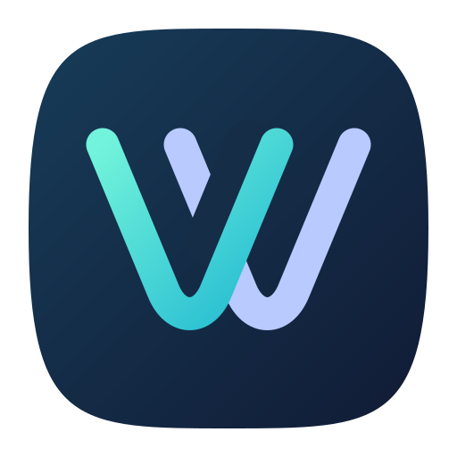

<div align="center">



# PortWeave · 端流

A macOS proxy client that connects your apps to different subscriptions through separate local ports.

**English** · [简体中文](README_zh_CN.md)

[Repository](https://github.com/Minggle/PortWeave) · [Test builds](https://github.com/Minggle/PortWeave/actions/workflows/ports-macos.yaml) · [Usage and development](PORT_ROUTING.md) · [Build status](MACOS_DEVELOPMENT.md)

</div>

PortWeave gives applications separate local proxy addresses backed by different subscriptions. A provider port can follow its original policy, use a fixed node, or select matching nodes. An aggregate proxy has its own listening port and routing groups, with a self-hosted route first and nodes from several subscriptions as backups.

**Development version: 0.9.4 · Flutter 3.50.0** (November 23, 2026). See [macOS development status](MACOS_DEVELOPMENT.md) for build, installation and real-network acceptance records.

## Choose how to route traffic

| Mode | What it does | Where to configure it |
| --- | --- | --- |
| Subscription ports | Gives each binding an HTTP / HTTPS CONNECT / SOCKS5 TCP port on `127.0.0.1` | **Tools → Subscription ports** |
| Original policy | Uses one subscription's rules, groups and saved group selections, isolated from other subscriptions | Select **Use original policy** for a port binding |
| Fixed node | Uses one exact node name from one subscription | Select a node for the binding |
| Keyword aggregation | Collects matching nodes from one or more selected subscriptions and automatically chooses by latency | Select sources and enter keywords such as `US\|美国` |
| Aggregate proxy | An independent port with the base profile's rules and ordered primary/backup groups across subscriptions | **Tools → Aggregate proxy**, then its page below **Proxies** |

Keyword matching is case-insensitive and uses node names, with `|` separating alternatives. It does not verify a node's country, bandwidth or access to a particular service. Fixed-node and keyword bindings reject new connections when their candidates disappear; they do not silently switch to another source or direct access. Original-policy bindings retain `DIRECT` / `REJECT` behavior and may route directly according to that policy.

## Start with subscription ports

1. Import subscriptions from links or files on the **Profiles** page.
2. Open **Tools → Subscription ports**, add a binding, and select its sources, port and policy. New bindings default to the original policy of one subscription.
3. Enable **Dedicated port mode**.
4. Enter the matching address in each app's own proxy settings.

| Example | Proxy address | Binding |
| --- | --- | --- |
| App A | `http://127.0.0.1:18082` | Subscription A's original rules and groups |
| App B | `socks5h://127.0.0.1:18083` | A fixed node from subscription B |
| App C | `http://127.0.0.1:18084` | Nodes matching `US\|美国` from subscriptions A and B |

Each port supports all three TCP proxy protocols. If an app asks for separate host and port fields, use `127.0.0.1` and the port you configured. The app must support an explicit proxy setting; this mode does not capture traffic by process.

Dedicated mode switches to a managed profile and disables the effective system proxy, TUN, external controller and default mixed port while preserving their saved settings. Turning it off restores the previous profile; choosing another ordinary profile also leaves this mode. PortWeave's own downloads use direct connections while dedicated mode is active.

Right-click a binding to copy its address, refresh subscriptions or change the update interval. Each subscription defaults to a five-minute interval; the scheduler checks for due work every 30 seconds while PortWeave is running. Fixed-node and keyword sources update locally and retain their last usable cache on failure. Refreshing a source used by an original-policy binding reapplies the managed configuration and can briefly reconnect traffic.

## Aggregate proxy: an independent port with ordered backups

Open **Tools → Aggregate proxy → Add**, choose a base subscription/file, a name and a free port such as `18084`, and select **Aggregate proxy**. The base file supplies routing rules and groups; its ordinary-profile extension script is not executed. Each binding appears below **Proxies** in the desktop sidebar. Open its page, then **Strategy groups and priorities**, to arrange local groups/nodes and subscription tiers for an existing business group. For example:

```text
Video group → self-hosted Taiwan group → US nodes from selected subscriptions → another backup tier
```

Each subscription tier can use several sources with include/exclude keywords and a match preview. Higher tiers remain preferred while their health checks succeed; lower latency in a backup tier does not override that order. Each subscription tier automatically chooses among its own candidates. Checks run every 60 seconds, and new connections return to a higher tier after it recovers. Existing connections are not guaranteed to migrate seamlessly.

Enable dedicated multi-port mode and the aggregate binding. An application using `http://127.0.0.1:18084` or `socks5h://127.0.0.1:18084` follows this aggregate configuration. Point it at a provider port such as `18082` to use that provider instead. Both ports can operate simultaneously for different applications.

Each port has its own page, enabled switch, rules and group namespace. Manual selector groups can be changed on that page while running. Groups without a priority enhancement retain the base definition; deleting an enhancement restores it. Source files stay unchanged. Subscription changes rebuild aggregate candidates and may briefly reconnect active traffic. Empty subscription tiers reject traffic; explicit `DIRECT` entries and direct rules in the base retain their meaning.

Legacy ordinary-profile priorities remain under **Tools → Aggregate proxy → Policy priorities** and apply only to the normal mixed port. Creating an aggregate port copies existing priorities for its base; **Copy priorities from base profile** replaces an existing port's priorities. Copies are independent afterwards.

## Choosing between the old mixed port and independent ports

| Route | Address configured in the application | Required state |
| --- | --- | --- |
| Ordinary profile | `127.0.0.1:7891`, or your saved mixed port | Dedicated mode off; ordinary profile selected and running |
| Individual provider | Its binding, for example `127.0.0.1:18082` | Dedicated mode and this binding enabled |
| Aggregate proxy | Its binding, for example `127.0.0.1:18084` | Dedicated mode and this aggregate binding enabled |

Dedicated mode closes the normal mixed port, TUN and system proxy while preserving their saved settings. Disabling dedicated mode restores the previous ordinary profile. `7890` is a common original FlClash default, while a new PortWeave install uses `7891`; explicit ports from imported backups remain unchanged. `9091` is the control API, not an application proxy port.

For example, `curl --proxy http://127.0.0.1:18084 https://example.com` uses the aggregate port. Change the proxy URL to `socks5h://127.0.0.1:18082` to use the provider binding. Replace example ports with the actual values on their pages.

## Independent macOS app and defaults

The macOS app is **`PortWeave.app`**, with its own icon, data, preferences, cache and login item. The build targets macOS 12 or later on Apple Silicon (`arm64`) and Intel (`amd64`); acceptance status is tracked in the [macOS development notes](MACOS_DEVELOPMENT.md). It can be installed alongside FlClash; import subscriptions or a backup on first use.

| Setting | Default |
| --- | --- |
| Ordinary mixed proxy port | `7891` |
| External controller | Off by default; when enabled, listens on `127.0.0.1:9091` with a secret generated if none is set |
| New subscription binding | Starts at `18082`, skipping ports already used by bindings |
| DNS listener | Disabled by default; the editor example uses `1054` |
| Release / Profile bundle ID | `io.github.minggle.portweave` |
| Debug bundle ID | `io.github.minggle.portweave.debug` |
| Registered URL scheme | `portweave://` |

Explicit ports in imported backups are preserved. The network port form's reset action restores `7891`. System proxy, TUN and listening ports remain shared host resources, so use dedicated mode and non-conflicting ports when running alongside another client.

The source tree also retains other platforms, including the earlier Windows subscription-port build. The current PortWeave product and delivery instructions focus on macOS; the [release history](RELEASE_PORTS.md) records the earlier Windows packages.

## Download and update

Open [PortWeave - macOS](https://github.com/Minggle/PortWeave/actions/workflows/ports-macos.yaml). The repository is public; downloading Actions artifacts requires signing in to GitHub with an account that has repository read access. Maintainers can use **Run workflow** to build a selected branch.

Choose a successful run for the intended commit and download the artifact for your architecture. The workflow produces `PortWeave-<version>-macos-<arch>.dmg` and `SHA256SUMS-macos-<arch>`. In the extracted artifact directory, verify the corresponding checksum file, for example:

```bash
shasum -a 256 -c SHA256SUMS-macos-arm64
```

Artifacts expire after one day, and only the latest run's artifacts are retained for each platform. Download the files you need while they are available.

Quit the installed PortWeave, open the DMG, drag `PortWeave.app` to Applications, then launch it yourself. **About → Download test version** opens the same build list. Updates are downloaded and installed manually; macOS does not query Releases on startup or replace the app automatically. These are development builds; Developer ID signing and Apple notarization are not complete.

## Current limits

- Subscription ports listen only on IPv4 loopback. They do not support UDP, LAN sharing or process-based interception.
- Port sources must contain top-level proxy nodes. Nested `proxy-providers`, direct-type nodes, duplicate names within one source and `dialer-proxy` chains are rejected. Matching names across different sources retain source identifiers.
- “Listening” means the current Core owns the port and a SOCKS handshake succeeded. It does not confirm an Internet exit or successful access to a service.

## Develop and verify

Use Flutter **3.50.0**, Go **1.27**, Rust via rustup, and full Xcode on macOS. Command Line Tools alone cannot build the app. Submodule URLs use SSH; configure GitHub SSH access before cloning recursively.

```bash
git clone --recursive https://github.com/Minggle/PortWeave.git
cd PortWeave
flutter pub get
flutter analyze --no-fatal-infos
flutter test test/common/port_routing_test.dart test/providers/port_routing_action_test.dart test/views/port_routing_test.dart
flutter test test/common/priority_policy_test.dart test/providers/priority_policy_action_test.dart test/views/priority_policy_test.dart
CGO_ENABLED=0 go test -C core . -run '^Test(PortRouting|PriorityPolicy)Wire$' -count=1
```

For local GUI development, use safe mode:

```bash
flutter run -d macos --dart-define-from-file=env.json --dart-define=SAFE_MODE=true
```

Safe mode keeps host network changes and proxy listeners off, so it cannot validate real proxy traffic. Run the full Flutter suite through `dart run tool/test.dart`; use `flutter test`, not `dart test`, for app tests. Regenerate code after model/provider/database changes with `dart run build_runner build --delete-conflicting-outputs`. Keep native build hooks enabled for package builds. See [development commands](.agents/commands.md), [port routing details](PORT_ROUTING.md) and [macOS build and acceptance notes](MACOS_DEVELOPMENT.md) for packaging commands and pending checks.

## Origin and license

PortWeave is based on [FlClash](https://github.com/chen08209/FlClash), using Flutter and the mihomo (Clash.Meta) core. The original FlClash authors (`com.follow`) and contributors retain attribution and copyright in their work; Minggle maintains the PortWeave adaptations. This project remains licensed under [GPL-3.0](LICENSE). Original notices and third-party licenses are retained.
